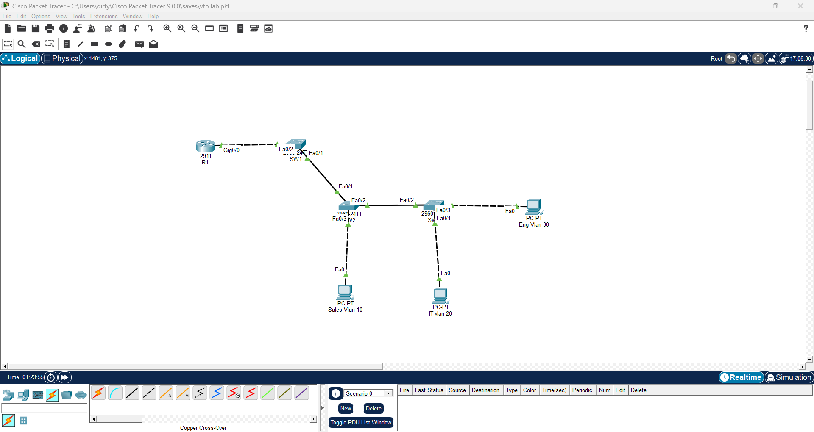
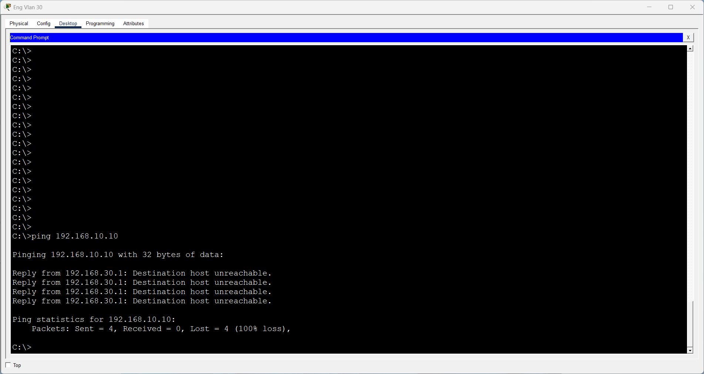
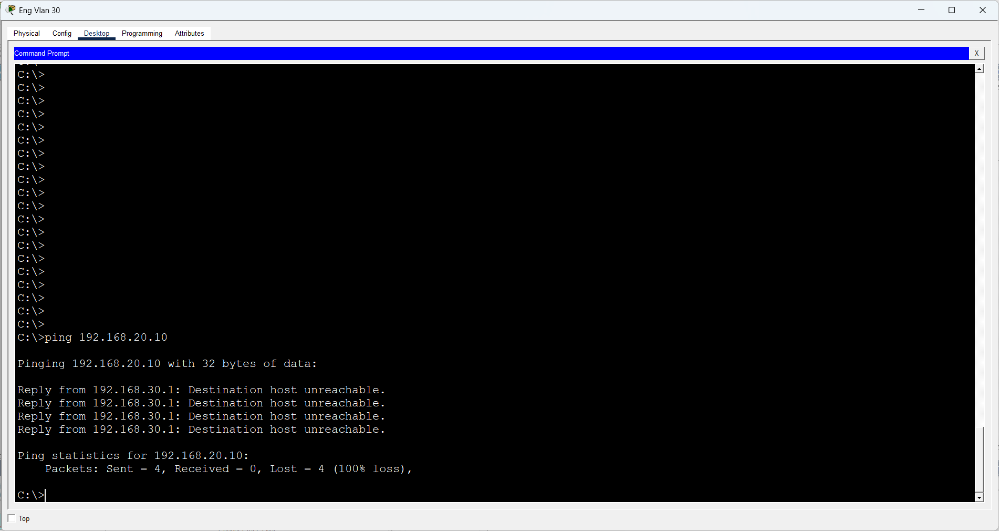
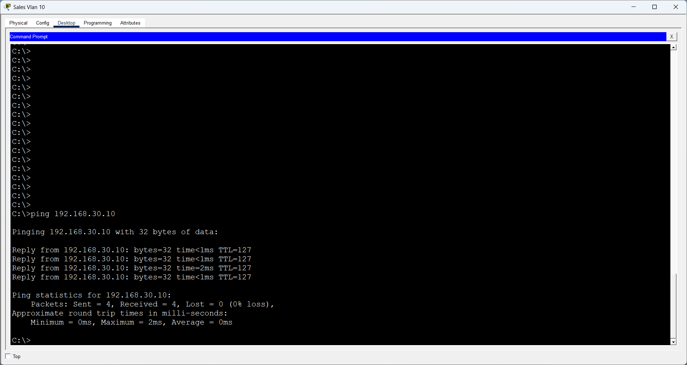
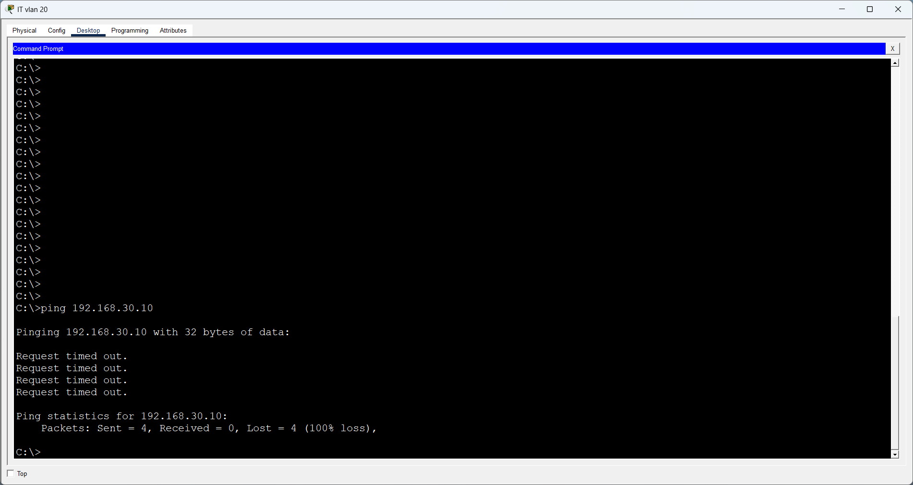
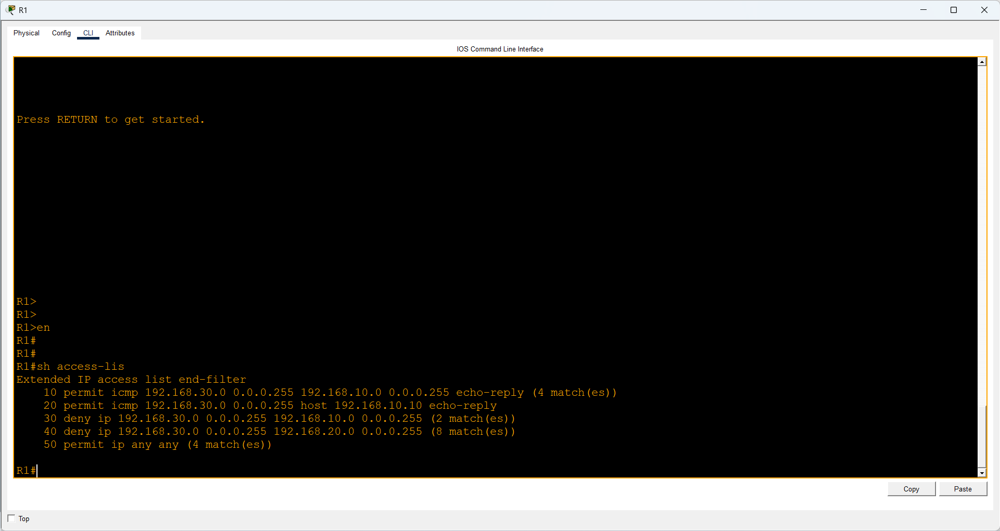
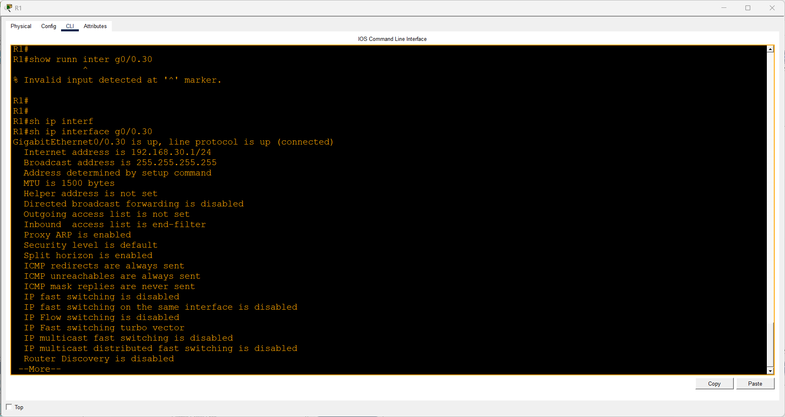

# VLAN Segmentation with Extended ACLs

A Cisco Packet Tracer lab using router-on-a-stick inter-VLAN routing and an inbound extended ACL on the Engineering VLAN subinterface. The ACL blocks Engineering from initiating traffic to Sales and IT while allowing ICMP echo replies to Sales, so Sales can initiate a ping to Engineering.

## Topology



The lab uses a Cisco 2911 router, three switches, and one PC in each tested VLAN.

## VLAN and addressing plan

| VLAN | Department | Subnet | Default gateway |
|---:|---|---|---|
| 10 | Sales | `192.168.10.0/24` | `192.168.10.1` |
| 20 | IT | `192.168.20.0/24` | `192.168.20.1` |
| 30 | Engineering | `192.168.30.0/24` | `192.168.30.1` |

The Engineering subinterface is `GigabitEthernet0/0.30`, with address `192.168.30.1/24`.

## ACL behavior

The named extended ACL `end-filter` is applied inbound on `GigabitEthernet0/0.30`. It checks packets entering the router from Engineering:

1. Permit ICMP echo replies from Engineering to Sales.
2. Deny other IP traffic from Engineering to Sales.
3. Deny IP traffic from Engineering to IT.
4. Permit remaining traffic.

The ACL is stateless. A Sales ping to Engineering succeeds because its echo reply is permitted. An IT ping to Engineering times out because the Engineering echo reply to IT is denied. Engineering-initiated pings to both Sales and IT are blocked.

Captured ACL configuration:

```text
ip access-list extended end-filter
 10 permit icmp 192.168.30.0 0.0.0.255 192.168.10.0 0.0.0.255 echo-reply
 20 permit icmp 192.168.30.0 0.0.0.255 host 192.168.10.10 echo-reply
 30 deny ip 192.168.30.0 0.0.0.255 192.168.10.0 0.0.0.255
 40 deny ip 192.168.30.0 0.0.0.255 192.168.20.0 0.0.0.255
 50 permit ip any any
!
interface GigabitEthernet0/0.30
 ip access-group end-filter in
```

## Verification

| Test | Result |
|---|---|
| Engineering `192.168.30.10` → Sales `192.168.10.10` | Blocked |
| Engineering `192.168.30.10` → IT `192.168.20.10` | Blocked |
| Sales `192.168.10.10` → Engineering `192.168.30.10` | Successful, 4/4 replies |
| IT `192.168.20.10` → Engineering `192.168.30.10` | Blocked; 4/4 requests timed out |
| Engineering → its default gateway `192.168.30.1` | Successful |
| Sales ↔ IT | Successful |

### Screenshots

**Engineering to Sales — blocked**



**Engineering to IT — blocked**



**Sales to Engineering — successful**



**IT to Engineering — blocked**



## ACL and interface evidence

The ACL counters show matches on the Engineering-to-Sales and Engineering-to-IT deny entries. The interface output confirms `end-filter` is applied inbound on `GigabitEthernet0/0.30`.





## Packet Tracer file

Open [`VLAN-Segmentation-Extended-ACLs.pkt`](VLAN-Segmentation-Extended-ACLs.pkt) with Cisco Packet Tracer.

## Note on the current ACL

The captured ACL includes two Sales echo-reply permits. The subnet-wide permit already covers `192.168.10.10`, so the following host-specific permit is redundant and shows zero matches in the capture. It can be removed without changing the tested behavior.
